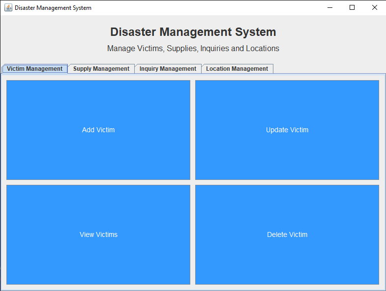
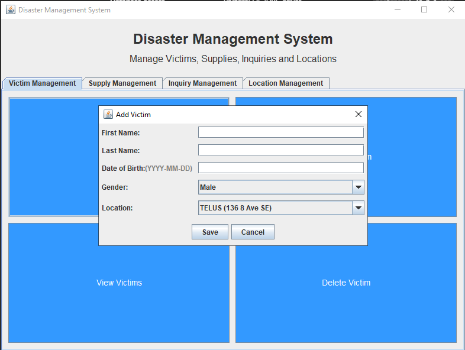

# DisasterManagementGUI

A modern, user-friendly Java GUI application for disaster response management. This tool helps organizations manage victims, supplies, inquiries, and locations efficiently, now supporting both **English** and **French**!

## 🌐 Language Selection
When you launch the program, you'll be greeted with a language selection screen:

.png)

Choose between English and French to use the app in your preferred language.

## 🖥️ Main GUI Overview
After selecting your language, you'll see the main dashboard, where you can manage all aspects of disaster response:



- **Victim Management**: Add, update, view, or delete disaster victims.
- **Supply Management**: Track and manage supplies.
- **Inquiry Management**: Handle external and victim inquiries.
- **Location Management**: Organize and update locations.

## ➕ Add Victim Menu
Easily add new victims with detailed information:



## 🚀 Getting Started

### Prerequisites
- Java 8 or newer
- PostgreSQL database (required when starting the GUI)

### 1. Download Dependencies
JARs are ignored by Git, so a fresh clone has no `lib/`. Create that folder
and download these three files into it:

- [PostgreSQL JDBC 42.7.3](https://repo.maven.apache.org/maven2/org/postgresql/postgresql/42.7.3/postgresql-42.7.3.jar)
- [JUnit 4.13.2](https://repo.maven.apache.org/maven2/junit/junit/4.13.2/junit-4.13.2.jar)
- [Hamcrest Core 1.3](https://repo.maven.apache.org/maven2/org/hamcrest/hamcrest-core/1.3/hamcrest-core-1.3.jar)

The classpath separator below is `;` on Windows. Use `:` on Linux or macOS.

### 2. Compile the Project
```sh
javac -cp "lib/*" -d out src/edu/ucalgary/oop/*.java
```

### 3. Run the Application
```sh
java -cp "out;lib/*" edu.ucalgary.oop.Main
```

### 4. Run the Tests
```sh
javac -cp "lib/*;out" -d out test/edu/ucalgary/oop/*.java
java -cp "out;lib/*" org.junit.runner.JUnitCore edu.ucalgary.oop.AllTests
```

## 🗄️ Database Connectivity
The application requires PostgreSQL for persistent data storage. Connection settings come from environment variables, so no credentials need to live in the source tree.

| Variable | Required | Default |
| --- | --- | --- |
| `DB_URL` | no | `jdbc:postgresql://localhost:5432/ensf380project` |
| `DB_USER` | no | `oop` |
| `DB_PASSWORD` | yes | none |

`DB_PASSWORD` has no default. Startup fails with an explicit message when it is unset. Set it to an empty value if your server uses trust authentication:

Windows PowerShell:

```powershell
$env:DB_URL = "jdbc:postgresql://localhost:5432/ensf380project"
$env:DB_USER = "oop"
$env:DB_PASSWORD = "your-password"
java -cp "out;lib/*" edu.ucalgary.oop.Main
```

Linux or macOS shell:

```sh
export DB_URL="jdbc:postgresql://localhost:5432/ensf380project"
export DB_USER="oop"
export DB_PASSWORD="your-password"
java -cp "out:lib/*" edu.ucalgary.oop.Main
```

If the database is unavailable, `DisasterManagementGUI` reports the connection error in a dialog and exits.

## 💡 Try It Yourself!
1. Clone this repository.
2. Make sure you have Java installed.
3. Compile and run using the steps above.
4. Explore the GUI, try adding victims, and see how easy disaster management can be!

---

Feel free to contribute or open issues for suggestions and improvements!
